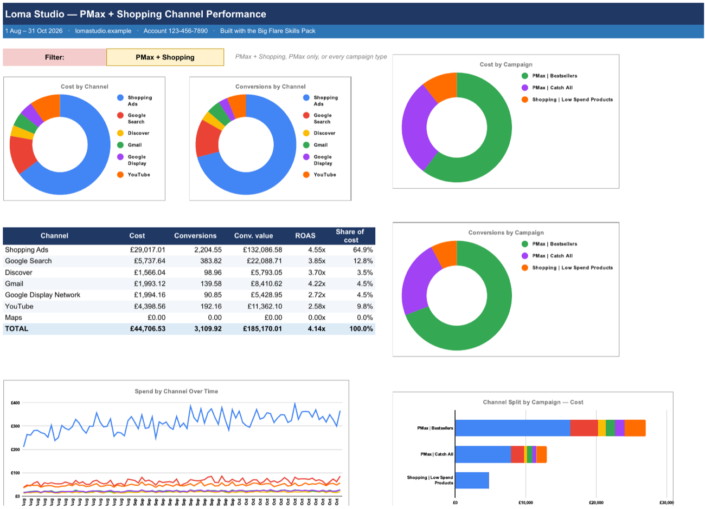

# Google Ads Audit Analysis

Build the analysis behind a Google Ads audit for your ecommerce store: one workbook that opens in Google Sheets and shows where your account's money goes and where the opportunities are.

It answers the questions an audit starts with. Did sales drop because of the account or the market? How much of your Performance Max budget really goes on Shopping ads, and how much on YouTube, Display and Gmail? Which products make money, which lose it, and which never get shown? Which searches convert in Performance Max but have no keyword you control?

Part of the [Big Flare Skills Pack](https://github.com/big-flare/skills-pack).



*The Channel Split tab, built from the demo data in this folder (a fictional store, every number made up).*

## Watch it in action

Video coming soon.

## What you get

A workbook, `<store>-google-ads-audit.xlsx`. Upload it to Google Drive and open it as a Google Sheet, or open it in Excel. Its tabs:

- **Start Here**: the headline numbers and a guide to the other tabs.
- **Account**: every month of last year and this year, across all campaign types. It shows conversions, cost, conv. value, ROAS, search impression share (and how much was lost to rank and to budget), and gross profit after ad spend, worked out from a gross margin you can edit.
- **Search Volume**: monthly Google searches for your main category keywords next to the impressions your account was eligible for, so you can tell a shrinking market from a shrinking account. Optional: it needs a Keyword Planner download (or a connection that provides one).
- **Channel Split**: where your Performance Max and Shopping spend goes: Shopping ads, Google Search, YouTube, Display, Gmail and Discover. It shows charts by channel and by campaign, and daily trends. A dropdown switches between PMax + Shopping, PMax only and your whole account.
- **Campaign**: the same channel split for any one campaign.
- **Assets**: how each Performance Max headline, description, image and video performs.
- **Products**: every product you list today, sorted into Profitable, Costly, Low spend and Zombies (no spend at all), with profit and POAS. Change the ROAS and cost thresholds or your margin, and every bucket, chart and table updates.
- **Product Families**: the same buckets for whole products, with sizes and colours grouped together, plus a mapping of which product IDs are in each.
- **Keyword Gap**: Performance Max searches that converted but have no working Search keyword. These are the keywords to add, or to unpause.

Claude also gives you a short summary of what stands out, with the numbers behind each point.

## What you need

- **Your Google Ads account.** Claude asks how you want to get the data out:
  1. **Google Ads connected:** if your Claude has a Google Ads connection that can run reports, it pulls the data itself.
  2. **A read-only script:** Claude gives you a Google Ads Script with your dates filled in. Paste it into Google Ads (Tools > Bulk actions > Scripts), click Run, and it saves one data file to your Google Drive for you to send to Claude. It only reads your account: it never changes a campaign, budget or setting. No API keys, developer tokens or Google Cloud setup needed.
  3. **Just looking?** Claude can build the report from the demo data in this folder first.
- **Your date range.** Claude suggests the last 90 days or year to date.
- **Your gross margin and targets, if you know them.** Defaults: 50% margin, 400% ROAS and a cost threshold of 50 in your currency. You can change all of them in the workbook.
- **Python.** The workbook is built by a small helper script (plain Python, nothing to install). Claude Code, Claude Desktop and claude.ai can all run it.

## How to use it

After installing, ask Claude in plain English. For example:

- "Audit my Google Ads account."
- "Build me the Google Ads audit analysis for the last 90 days."
- "Where is my Performance Max spend actually going?"
- "Which of my products are making money in Google Shopping, and which aren't?"
- "Our sales dropped this year. Is it Google Ads or the market?"
- "Show me what the audit analysis looks like with the demo data."

Claude asks for the date range and how to get the data, then the settings, builds the workbook and talks you through the findings.

## Install

The easiest route is to install the whole pack, which also gets you updates. See [Install](https://github.com/big-flare/skills-pack#install) in the main README.

To add just this skill to Claude Code:

```bash
git clone https://github.com/big-flare/skills-pack.git
cp -R skills-pack/skills/google-ads-audit-analysis ~/.claude/skills/
```

Copying into `~/.claude/skills/` makes it available in every project. To keep it to one project, copy it into that project's `.claude/skills/` folder instead. A copied folder stays at the version you copied; pull the repo again to update.

## What's in this folder

| File | What it does |
|---|---|
| `SKILL.md` | The workflow Claude follows, step by step |
| `references/queries.md` | The Google Ads queries behind every tab, and how to save results from a connection |
| `references/reading-the-report.md` | What to look for on each tab |
| `references/bigflare-badge.png` | The logo on the Start Here tab |
| `scripts/audittool.py` | The helper script: reads the data, does the maths and builds the workbook |
| `scripts/xlsxlite.py` | Writes the workbook file, charts and dropdowns included (used by `audittool.py`) |
| `scripts/export-data.js` | The read-only Google Ads Script, for when Google Ads isn't connected |
| `examples/` | Demo data for a fictional store, a sample Keyword Planner download, and the picture above |

## About Big Flare

[Big Flare](https://bigflare.com) is a Google Ads agency for ecommerce brands. This skill is a working version of the analysis we run before we audit an account. More free skills are in the [Big Flare Skills Pack](https://github.com/big-flare/skills-pack), and each one gets a video on the [Big Flare YouTube channel](https://www.youtube.com/channel/UCKEZmHEEOMuvT2PBU3owpQA).
